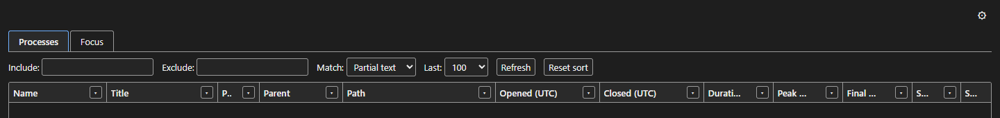

# ProcessLogger

Catch whatever stole focus from your game: ProcessLogger records every Windows process start and exit, even sub-second ones, with memory peaks and every foreground-window change, in a filterable viewer.

    


A window flashes up and your full-screen game drops to the desktop. Task Manager shows nothing, because whatever did it lived for half a second. ProcessLogger is a pair of small Windows apps that answer that question: a background logger that writes every process lifecycle and focus change to a local SQLite database, and a viewer to search it.

## Why

- Find the process that launched and exited before you could see it; the kernel trace catches processes that live only a fraction of a second.
- See what actually took the foreground, and when, next to what was running at that moment.
- Know who started it: each row carries the parent process name, the executable path and the command line.
- See how heavy it was: peak working set, peak private bytes and the last working set before exit.
- Trust the record: two independent capture sources are reconciled, and each row says which of them saw it.
- Keep it all local: one SQLite file under your own profile, nothing sent anywhere.

## Features



Logger (`ProcessLogger.Cli`):

- **ETW kernel process trace** (the NT Kernel Logger session, via TraceEvent). The kernel raises these events as part of process creation and exit, so nothing is missed between polls.
- **WMI process trace** (`Win32_ProcessStartTrace` and `Win32_ProcessStopTrace`) as a redundant cross-check and as the fallback when another tool already owns the kernel session.
- **Reconciler:** if both sources report the same PID within 250 ms they are merged into one row (preferring ETW's richer path and command line), and the Source column reads `Both`; otherwise it reads `Etw` or `Wmi`.
- **Memory sampling** every 50 ms while a process is alive (up to 200 samples): peak working set, peak private bytes, final working set and the sample count.
- **Window title** of the process's main window, sampled shortly after start (best effort).
- **Focus log:** a `SetWinEventHook` foreground hook records each window that takes focus, with its process, title, and focused and lost times.

Viewer (`ProcessLogger.Frontend`):

- **Processes** and **Focus** tabs over the same database.
- **Include and exclude** text filters with Partial text, Exact string or Regex matching, and the last 50 to 1000 rows.
- **Per-column value filters,** sortable columns (newest first by default, with Reset sort) and resizable column widths that are remembered across restarts.
- **Auto-refresh** every 1 second to 20 minutes, and a System, Light or Dark theme.

## Quick start

Prerequisites: Windows, the .NET 10 SDK, the Microsoft Edge WebView2 runtime, and an administrator account (the logger needs elevation for ETW and WMI tracing).

```powershell
git clone https://github.com/mindattic/ProcessLogger.git
cd ProcessLogger
.\launch.bat
```

`launch.bat` publishes both apps in Release to `C:\Apps\ProcessLogger\Cli` and `C:\Apps\ProcessLogger\Frontend` and starts them. Windows shows a UAC prompt for the logger, which is marked `requireAdministrator` in its manifest. When it is running, the logger console shows:

```text
ProcessLogger is watching. Press Ctrl+C to stop.
```

Leave the logger running, reproduce the problem, then switch to the viewer and filter.

## Configuration

The logger reads `appsettings.json` next to `ProcessLogger.Cli.exe`:

```json
{
  "ProcessLogger": {
    "EnabledSources": "Both",
    "DatabasePath": null
  }
}
```

| Setting | Default | Meaning |
|---|---|---|
| `EnabledSources` | `Both` | Which capture sources run: `Etw`, `Wmi` or `Both` |
| `DatabasePath` | `null` | SQLite file path; `null` means `%LOCALAPPDATA%\MindAttic\ProcessLogger\processlogger.db` |
| `ReconcileWindowMs` | `250` | How long to wait for the second source to confirm a PID before writing a single-source row |

The database runs in SQLite WAL mode, so the viewer can read while the logger writes.

## How it works

```text
 ProcessLogger.Cli (elevated)                                   ProcessLogger.Frontend
 ┌──────────────────────────────────────────────┐               ┌──────────────────────────┐
 │ EtwProcessCaptureSource ──┐                  │               │ WPF + WebView2           │
 │                           ├─> ProcessWatcher │               │ wwwroot/index.html       │
 │ WmiProcessCaptureSource ──┘    reconcile by  │               │   Processes | Focus      │
 │                                PID (250 ms)  │               │   filters, sort, columns │
 │                                  │           │               └────────────┬─────────────┘
 │                    MemorySampler (50 ms)     │                            │ query services
 │ FocusWatcher (foreground hook)   │           │                            │
 └──────────────┬───────────────────┴───────────┘                            │
                └──────────> processlogger.db (SQLite, WAL) <────────────────┘
                             ProcessEvents, FocusEvents
```

Notes on the data:

- Windows does not expose "how much memory a process gave back" for a foreign process. `FinalWorkingSetBytes`, the last sample before exit, is the closest observable proxy.
- A sample count of 0 means the process lived shorter than one sampler tick.
- Path and command line are only reliably supplied by the ETW source.
- A stop for a process that was already running when the logger started is ignored; there is no row to close.

## Building and testing

```powershell
dotnet build ProcessLogger.slnx
dotnet test ProcessLogger.Tests
```

The NUnit tests cover the reconciling watcher (with a fake capture source) and the process and focus query services, against SQLite. The build treats warnings as errors (`Directory.Build.props`).

## Project layout

| Project | Role |
|---|---|
| `ProcessLogger.Core` | Capture sources, reconciler, memory sampler, focus watcher, EF Core model and migrations, query services |
| `ProcessLogger.Cli` | Elevated generic host that runs the watchers and applies migrations at start |
| `ProcessLogger.Frontend` | WPF + WebView2 viewer; vanilla HTML, CSS and JS in `wwwroot` |
| `ProcessLogger.Tests` | NUnit tests |

## Limitations

- Windows only, and the logger must run elevated.
- Only one NT Kernel Logger session can exist system-wide. If another tool owns it, the ETW source logs an error and stays off, and WMI carries on alone (WMI has about 1 to 2 seconds of startup latency and can drop rapid bursts).
- The viewer always opens the default database path; a custom `DatabasePath` in the logger's settings is not picked up by the viewer.
- Window titles are best effort: background and console processes have none, and a GUI window may not exist yet when it is sampled.

## Documentation

- [AGENTS.md](AGENTS.md): entry point for AI agents working in this repo; it points at the shared MindAttic agent standard.

## License

This repository has no LICENSE file; all rights are reserved.

Part of [MindAttic](https://mindattic.com) — see more projects at [github.com/mindattic](https://github.com/mindattic). Related: [JobHunt](https://github.com/mindattic/JobHunt), which uses the same WPF + WebView2 hosting pattern.
